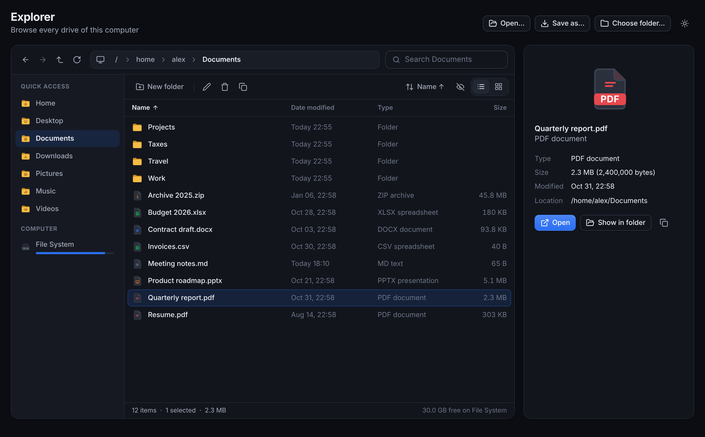
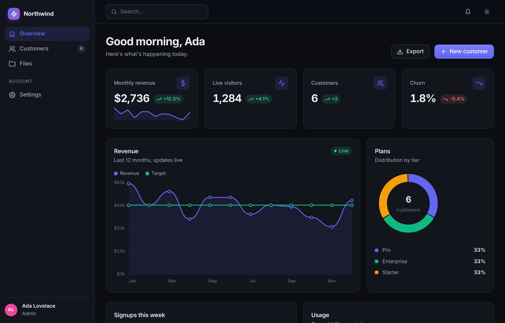
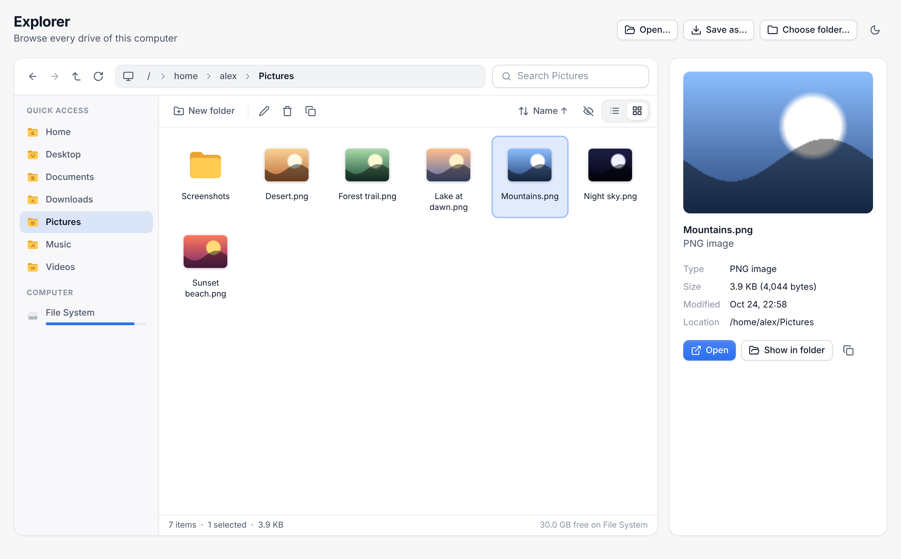
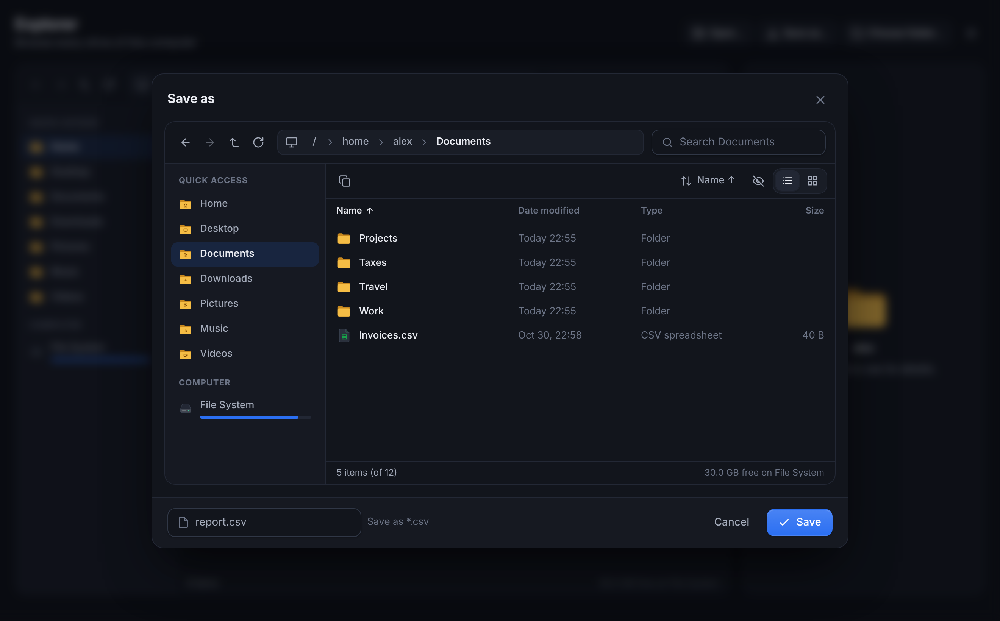
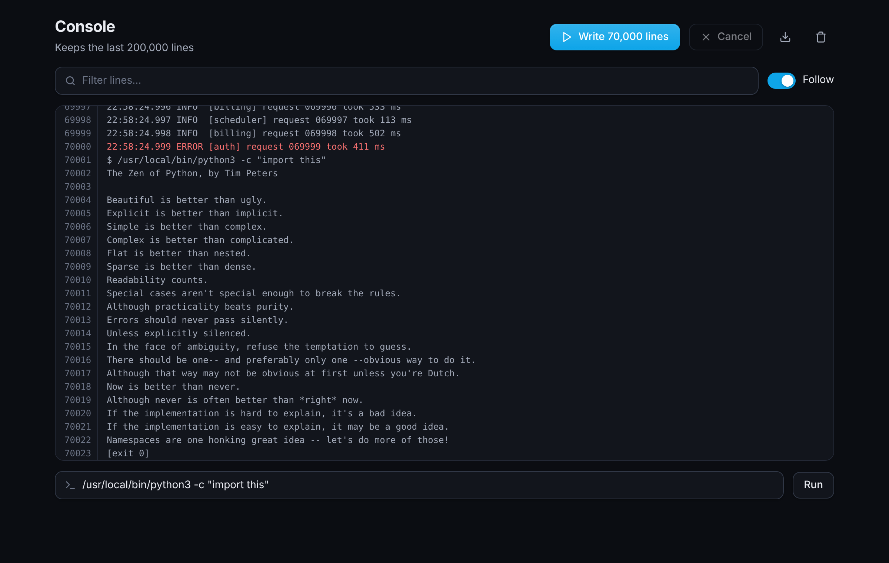
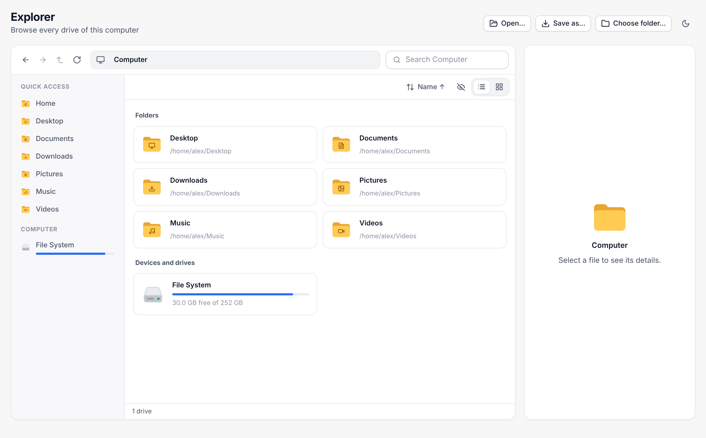

<div align="center">


# ZePyGUI

**Beautiful native desktop apps in pure Python. Zero dependencies.**

[](https://github.com/rzafiamy/zepygui/actions/workflows/ci.yml)
[](https://pypi.org/project/zepygui/)
[](https://pypi.org/project/zepygui/)
[](LICENSE)


[Quick start](#quick-start) · [File browsing](#file-browsing) · [Components](#components) · [Heavy work](#heavy-work) · [Performance](#performance) · [Examples](#examples) · [Contributing](CONTRIBUTING.md)



</div>

ZePyGUI works like Tauri, but you write Python instead of Rust and JavaScript. Your app runs in
a real window using the operating system's web engine, comes with a polished design system,
updates itself when your data changes, and sends the window only what changed.

```python
from zepygui import App, State, ui

app = App("Hello")
count = State(0)

@app.page("/")
def home():
    return ui.column(
        ui.h1(f"Clicked {count.value} times"),
        ui.button("Click me", lambda: count.set(count.value + 1)),
    )

app.run()
```

No Node, no Rust toolchain, no dependencies: only Python 3.9+.

---

## Why ZePyGUI

| | |
|---|---|
| **Native window** | On macOS, a real `NSWindow` + `WKWebView` (the approach Tauri takes), driven via `ctypes`. On Windows and Linux, a chrome-less Edge/Chromium app window. Native menu bar, copy/paste, full screen, a title bar that follows your theme, remembered window size. |
| **No dependencies** | Only the standard library. Nothing to install, nothing to break, trivial to bundle. |
| **Beautiful by default** | 55+ components, 100+ icons, coloured file-type icons, dark and light themes, one accent colour drives the palette. |
| **File browsing built in** | An Explorer-like `ui.file_browser` and an in-app `ui.file_dialog`, with Windows drives, known folders, hidden attributes and the Recycle Bin handled for you. |
| **Fast** | Incremental renders (a keystroke above a 5,000-row table sends 0.6 KB, not 0.9 MB), virtual lists and tables, a log console for 100,000+ lines, renders coalesced to one per frame. |
| **Reactive** | Change a `State` and every window that shows it re-renders, even from background threads. |
| **Built for heavy work** | Background tasks with progress and cancel (threads, processes or asyncio), streamed command output. |
| **Validation** | Rules, live field errors and validated submits, including errors sent back by your backend. |
| **Dev friendly** | `reload=True` restarts on save, `debug=True` enables the inspector, `python -m zepygui new` scaffolds an app. |

<table>
<tr>
<td width="50%"></td>
<td width="50%"></td>
</tr>
<tr>
<td align="center"><sub><code>examples/dashboard.py</code>: sidebar, live charts, stats, tables</sub></td>
<td align="center"><sub><code>examples/explorer.py</code>: icon view with thumbnails and preview</sub></td>
</tr>
<tr>
<td width="50%"></td>
<td width="50%"></td>
</tr>
<tr>
<td align="center"><sub><code>ui.file_dialog(mode="save")</code>: the same dialog on every OS</sub></td>
<td align="center"><sub><code>examples/console.py</code>: 70,000 lines, filter, run commands</sub></td>
</tr>
</table>

### How it works

```
 Your Python code ──► builds a tree of components ──► diffed against what the window shows
        ▲                                                       │  only the changes are sent
        └──────────── events (click, input, …) ◄────────────────┘
```

* **macOS**: native `NSWindow` + `WKWebView`. No server and no network port: Python and the UI talk
  through a WebKit script-message bridge.
* **Windows / Linux**: a frameless app window using the system's Edge/Chromium (Edge ships with
  Windows), talking to Python over a private, token-protected loopback channel. Same API; native
  WebView2/WebKitGTK backends can be added without changing any app code.

---

## Quick start

Install from [PyPI](https://pypi.org/project/zepygui/):

```bash
python3 -m pip install zepygui
```

Or from a clone, in editable mode:

```bash
git clone https://github.com/rzafiamy/zepygui.git
```

```bash
cd zepygui && python3 -m pip install -e .
```

Create and run an app:

```bash
python3 -m zepygui new myapp
```

```bash
python3 myapp/app.py
```

## Examples

Every example runs from a clone without installing anything:

| Command | What it shows |
|---|---|
| `python examples/hello.py` | the smallest app: a counter |
| `python examples/todo.py` | a to-do list with keyed items |
| `python examples/dashboard.py` | a full app: sidebar, live charts, table, modal, settings, native dialogs |
| `python examples/explorer.py` | a file explorer: drives, quick access, details/icons views, previews, rename/delete, in-app dialogs |
| `python examples/console.py` | a log console: 70,000 lines, filter, run commands, export |
| `python examples/files.py` | scan a folder tree in the background, 100k-row table, hashing in a process |
| `python examples/signup.py` | form validation with live and server-side errors |

---

## File browsing

### `ui.file_browser`: Explorer and Finder in one call

```python
from zepygui import App, State, fs, ui

app = App("Files")
folder = State(fs.home())        # two-way: follows the user's navigation
picked = State([])

@app.page("/")
def home():
    return ui.file_browser(
        folder,
        on_select=picked.set,     # called with the selected paths
        on_open=ui.open_path,     # double-click / Enter on a file (this is the default)
        manage=True,              # New folder, Rename (F2), Delete to the Recycle Bin / Trash
        height=600,
    )

app.run()
```

What you get:

* **Quick access** (Home, Desktop, Documents, Downloads, Pictures, Music, Videos) and **This PC** with
  every drive, its label and a usage bar. A breadcrumb address bar you can also type into
  (`%USERPROFILE%\Downloads`, `~/Documents`, a UNC share…), back / forward / up / refresh.
* **Details view** (sortable Name, Date modified, Type, Size) and **icon view** with image thumbnails.
* **Search** as you type, with `*` and `?` wildcards; `types=["png", "jpg"]` to show only some files;
  `folders_only=True`; hidden files on demand.
* **Selection** with click, Ctrl/Cmd-click and Shift-click; **keyboard**: arrows, Home/End,
  PageUp/PageDown, Enter, Backspace, Alt+←/→, F2, Delete, F5, Ctrl+A, and type-ahead.
* **Large folders stay fast**: listings are cached and revalidated with one `stat`, rows use one
  delegated event handler, folders over 400 entries render only the rows in view, and a slow folder
  (a network share, a USB stick) is read in the background behind a placeholder.

### `ui.file_dialog`: the same dialog on every OS

```python
show = State(False)
ui.button("Export…", lambda: show.set(True))
ui.file_dialog(show, mode="save", default_name="report.csv", types=["csv"], on_done=export)
# mode="open" (multiple=True for a list), "save" (adds the extension, asks before replacing) or "folder"
```

It is a file browser in a modal: it never opens behind the window and needs no external program.
The system dialogs are still there: `ui.open_file()`, `ui.save_file()`, `ui.choose_folder()`.
On Windows these are the native common dialogs called directly through `ctypes` (instant, owned by
the app window); PowerShell is only a fallback.

### `zepygui.fs`: the file system as a file browser sees it

```python
from zepygui import fs

fs.drives()                    # [{"name": "Local Disk (C:)", "path": "C:\\", "kind": "fixed", "free": …}, …]
fs.places()                    # known folders: from the Windows shell (OneDrive redirection included) or XDG
fs.listdir(path, sort="size")  # Entry objects: name, path, is_dir, size, modified, kind, ext, hidden
fs.crumbs(r"C:\Users\me")       # [("Local Disk (C:)", "C:\\"), ("Users", "C:\\Users"), ("me", …)]
fs.trash(path)                 # Recycle Bin / Trash, never a permanent delete
fs.human_size(1536)            # "1.5 KB"
ui.file_icon("report.pdf", 48) # a coloured two-tone icon for any file type, folder or drive
ui.image(fs.file_url(path))    # show a local file in any run mode
```

On Windows, drives come from `GetLogicalDrives` (without "no disk" pop-ups for empty card readers),
known folders from `SHGetKnownFolderPath`, hidden files from their attributes, and deletion goes
through `SHFileOperation` to the Recycle Bin.

<p align="center"></p>

---

## The basics

### Pages

```python
@app.page("/", title="Home")
def home():
    return ui.h1("Home")

@app.page("/user/{id:int}", title="Profile")   # parameters: {name}, {name:int}, {name:float}, {name:path}
def profile(id):
    return ui.h1(f"User #{id}")
```

Navigate with `ui.link("Profile", to="/user/3")`, `ui.nav_item(...)`, or `ui.navigate("/user/3")`.

### State: the UI updates itself

```python
count = State(0)           # shared by all windows of the app

count.value                # read (inside a page, this subscribes the window)
count.set(5)               # write → UI re-renders
count.value += 1           # also works
count.update(lambda n: n * 2)

todos = State([])
todos.append("Write docs")  # list helpers: append, remove, pop, insert, clear, extend
todos.value[0] = "Edited"
todos.notify()              # after mutating in place yourself
```

**Local state** for one page or component uses `ui.use_state`:

```python
@app.page("/search")
def search():
    query = ui.use_state("")
    return ui.input(query, placeholder="Search…")    # a State as `value` means two-way binding
```

### Two ways to write layouts

Nested calls:

```python
ui.card(
    ui.h3("Sign in"),
    ui.input(email, label="Email"),
    ui.button("Continue", login, full=True),
)
```

…or `with` blocks:

```python
with ui.card():
    ui.h3("Sign in")
    ui.input(email, label="Email")
    ui.button("Continue", login, full=True)
```

### Reusable components

```python
@ui.component
def Counter(label):
    n = ui.use_state(0)                       # each Counter keeps its own count
    return ui.button(f"{label}: {n.value}", lambda: n.set(n.value + 1))

ui.row(Counter("Apples"), Counter("Pears"))
```

In lists, give items a `key=` so their state follows them when the list is reordered.

### Event handlers

Handlers can take zero or one argument; ZePyGUI passes the argument only if your function accepts it.

```python
ui.button("Save", on_click=save)                       # save()
ui.input(on_change=lambda text: print(text))           # gets the text
ui.input(on_enter=lambda text: send(text))
ui.select(["S", "M", "L"], on_change=set_size)         # gets the chosen option
ui.el("div", "Hover me", on_mouseenter=lambda e: ...)  # any DOM event, gets an Event

async def load():                                      # async handlers work too
    await asyncio.sleep(1)
    data.set(await fetch())
```

A handler runs on its window's thread, so a slow one freezes that window (ZePyGUI prints a
warning when a handler takes longer than 250 ms). Move slow work into a [task](#heavy-work).

### App shell layout

```python
@app.layout
def layout(content):
    return ui.shell(
        content,
        sidebar=ui.sidebar(
            ui.nav_item("Home", "/", icon="home"),
            ui.nav_item("Inbox", "/inbox", icon="mail", badge=3),
            ui.nav_section("Account"),
            ui.nav_item("Settings", "/settings", icon="settings"),
            title="Acme", logo="zap",
        ),
        header=ui.header(ui.spacer(), ui.theme_toggle()),
    )
```

---

## Components

**Layout:** `column`, `row`, `grid`, `container`, `card`, `spacer`, `divider`, `scroll_area`,
`shell`, `sidebar`, `nav_item`, `nav_section`, `header`

**Text:** `h1`–`h4`, `text`, `link`, `code`, `code_block`, `markdown`, `kbd`

**Inputs:** `button`, `icon_button`, `input`, `textarea`, `checkbox`, `switch`, `slider`, `select`,
`radio_group`, `segmented`, `form`

**Display:** `badge`, `avatar`, `icon`, `image`, `progress`, `spinner`, `alert`, `stat`, `table`,
`tabs`, `accordion`, `modal`, `tooltip`, `empty_state`, `theme_toggle`

**Charts:** `line_chart`, `bar_chart`, `donut`, `sparkline`

**Large data:** `virtual_list`, `log_view`, and `table(..., virtual=True)`

**Files:** `file_browser`, `file_dialog`, `file_icon`, `breadcrumbs` (see [File browsing](#file-browsing))

**Actions:** `toast`, `navigate`, `set_theme`, `toggle_theme`, `set_title`, `copy`, `run_js`, `background`

**Desktop:** `open_file`, `save_file`, `choose_folder`, `notify`, `open_url`, `open_path`, `file_url`

A few examples:

```python
ui.button("Delete", on_click=delete, variant="danger", icon="trash")   # primary/secondary/outline/ghost/soft/danger/success
ui.input(email, label="Email", type="email", icon="mail", error="Invalid email" if bad else None)
ui.switch("Dark mode", dark)
ui.slider(volume, min=0, max=100, label="Volume", format=lambda v: f"{v}%")
ui.grid(ui.stat("Revenue", "$12k", delta="+8%", icon="dollar"), ..., cols=4)

ui.table(users, [
    ("name", "Name"),
    {"key": "role", "label": "Role", "format": lambda v: ui.badge(v, "blue")},
    {"key": "spent", "label": "Spent", "align": "right", "format": lambda v: f"${v:,}"},
], on_row_click=open_user)                                              # sortable by default

ui.tabs({"Profile": profile_tab, "Billing": billing_tab}, variant="pills")
ui.modal(show_dialog, ui.text("Are you sure?"), title="Confirm",
         footer=[ui.button("Cancel", close, variant="ghost"), ui.button("Yes", confirm)])
ui.line_chart({"Sales": [3, 5, 4, 8], "Costs": [2, 3, 3, 4]}, ["Q1", "Q2", "Q3", "Q4"])
ui.donut({"Free": 120, "Pro": 45, "Team": 12}, center_label="users")
```

Every component accepts `cls=`, `style=` and `key=`, and any other keyword becomes an HTML attribute.
Spacing (`gap`, `padding`) uses a 4px scale: `gap=4` is 16px. Strings like `"1.5rem"` pass through.

### Desktop features

```python
path = ui.open_file("Choose an image", types=["png", "jpg"])        # None if cancelled
paths = ui.open_file(multiple=True)
target = ui.save_file("Export", "report.csv")
folder = ui.choose_folder()
ui.notify("Export finished", "report.csv was saved")                # system notification
ui.open_path(target, reveal=True)                                   # show in Finder/Explorer
```

### Background updates

```python
@app.timer(1.0)
def tick():
    clock.set(time.strftime("%H:%M:%S"))     # every open window updates
```

---

## Heavy work

### Tasks: keep the window responsive

`ui.task` runs a function in the background and returns a `Task` at once. Its `status`,
`progress` and `message` are `State`s, so a page that reads them updates by itself.

```python
def copy_folder(src, dst, task):              # a parameter named `task` receives the Task
    files = list(Path(src).rglob("*"))
    for i, f in enumerate(files):
        task.check()                          # raises Cancelled once task.cancel() is called
        shutil.copy2(f, dst)
        task.report((i + 1) / len(files), f.name)
    return len(files)

job = ui.task(copy_folder, src, dst,
              on_done=lambda n: ui.toast(f"{n} files copied", "success"),   # on the window's thread
              on_error=lambda e: ui.toast(str(e), "error"))

ui.progress(job.progress.value * 100 if job.progress.value is not None else 0, label=job.message.value)
ui.button("Cancel", job.cancel)
```

| Kind of work | How | Runs on |
|---|---|---|
| Blocking I/O: files, network, databases | `ui.task(fn, ...)` | shared thread pool (`min(32, cpu + 4)` threads) |
| `async def` code | `ui.task(coro_fn, ...)`, or an async handler | one shared asyncio loop |
| CPU-heavy pure functions: hashing, parsing, images | `ui.task(fn, ..., process=True)` | process pool, one process per core |
| External programs | `ui.run_command(cmd, log=log, on_line=...)` | a reader thread per command |

`process=True` re-imports your script in each worker process: guard `app.run()` with
`if __name__ == "__main__":` (ZePyGUI also refuses to open a window from a worker).
`ui.background(fn, *args)` is the old spelling of `ui.task(fn, *args)`.

Changing `State` from a task is safe and cheap: each window queues at most one redraw and
renders at most once per frame (60 per second), however fast the values change.

### A log console for 100,000+ lines

A `Log` sends each window only the lines it has not seen yet. The window keeps the lines and
draws only the ones on screen, so appending stays fast however long the log gets.

```python
log = Log(max_lines=200_000)                  # oldest lines are dropped beyond this

ui.log_view(log, height=480, filter=query, numbers=True)   # follows the newest line, tints ERROR/WARN
ui.run_command(["pytest", "-x"], log=log)                  # stream a command's output into it
log.append("done")                                         # from any thread
print("also works", file=log)
log.save("session.log"); log.clear()
```

### Tables and lists with 100,000+ rows

```python
ui.table(rows, columns, max_height=480)       # above 1,000 rows it renders only the rows in view
ui.table(rows, columns, virtual=True, row_height=32)
ui.virtual_list(files, lambda f: ui.row(ui.icon("file"), ui.text(f["name"])), item_height=36, height=480)
```

Virtual rows have a fixed height and their cells don't wrap.

---|---|---|
| Render 5,000 table rows | 3,640 ms | 277 ms |
| Render a 5,000-row keyed list | 7,107 ms | 511 ms, payload 5.5 → 4.2 MB |
| Render a 100,000-row table | (minutes) | 5 ms, 12 KB (virtual) |
| Scroll a 100,000-row table to new rows | — | ~30 ms per step |
| 50,000 `State.set()` from a thread until the window shows the last | 581 ms, 48 renders | 228 ms, 9 renders |
| Stream 70,000 log lines into a window | — | 250 ms, 31 messages |
| Click while slow work runs | 504 ms (blocked) | 22 ms (`ui.task`) |
| Memory kept after rendering 5,000 rows | 24 MB until the GC runs | 1.9 MB, no garbage cycles |

---

## Validation

Give an input a `Field` instead of a `State`: it binds the value, shows the error and marks
the field required.

```python
from zepygui import rules, ValidationError

@app.page("/signup")
def signup():
    form = ui.use_form(
        email=("", [rules.required(), rules.email()]),
        password=("", [rules.required(), rules.min_length(8)]),
        confirm=("", [rules.matches("password", "Passwords don't match")]),
        age=(None, [rules.number(min=18, integer=True)]),
        terms=(False, [rules.required("Accept the terms to continue")]),
    )
    return ui.form(
        ui.input(form.email, label="Email"),
        ui.input(form.password, type="password", label="Password"),
        ui.input(form.confirm, type="password", label="Confirm"),
        ui.input(form.age, type="number", label="Age"),
        ui.checkbox("I accept the terms", form.terms),
        ui.button("Create account", submit=True, loading=form.submitting.value),
        on_submit=form.submit(create_account, background=True, reset=True),
    )

def create_account(values):                   # called only when every field is valid
    if db.exists(values["email"]):
        raise ValidationError({"email": "Already registered"})   # shown under the field
    db.insert(values)
```

* An error appears once the user leaves the field (or submits), then follows what they type.
* Rules: `required`, `min_length`, `max_length`, `pattern`, `email`, `url`, `number(min, max, integer)`,
  `one_of`, `matches(field)`, and `check(predicate, message)` for your own.
* A single field: `name = ui.use_field("", rules.required())`, then `ui.input(name)`.
* `form.values()`, `form.errors()`, `form.valid`, `form.reset()`, `form.set_errors({...})`.

---

## Customizing

```python
app = App(
    "My App",
    theme="auto",            # "auto" (follows the OS), "dark" or "light"
    accent="#10b981",        # one color drives the whole palette
    width=1200, height=800, min_size=(600, 400),
    radius=12,               # corner roundness
    font="'Inter', sans-serif",
    icon="icon.png",         # dock icon (macOS)
)

app.add_css(""".hero { background: linear-gradient(135deg, var(--accent), #ec4899); }""")
app.static("/assets", "assets")       # then ui.image("assets/logo.png")
ui.register_icon("diamond", "M12 2 22 12 12 22 2 12Z")   # SVG paths on a 24x24 grid
```

Theme variables you can use in your CSS: `--accent`, `--bg`, `--surface`, `--surface-2`, `--border`,
`--text`, `--text-2`, `--muted`, `--green`, `--red`, `--yellow`, `--blue`, `--radius`, `--shadow`.

### Escape hatches

```python
ui.el("video", src="intro.mp4", controls=True, autoplay=True)   # any HTML tag
ui.html("<marquee>raw HTML</marquee>")                          # raw markup (trusted content only)
ui.run_js("document.body.requestFullscreen()")

@app.expose                       # call Python from your own JavaScript:
def add(a, b):                    #   const sum = await zepygui.call("add", 2, 3)
    return a + b
```

### Run options

```python
app.run()                    # native window (macOS) / app window (Windows, Linux)
app.run(reload=True)         # restart on file save, for development
app.run(debug=True)          # right-click → Inspect Element
app.run(mode="window")       # force the Edge/Chromium app window
app.run(mode="browser")      # open in your default browser (handy for dev tools)
app.run(mode="server")       # open nothing, print the address (remote use, screenshots, CI)
```

`ZEPYGUI_MODE=server` and `ZEPYGUI_PORT=8765` override the mode and port without editing the code.

---

## Performance

`python3 bench/bench.py` measures the runtime headless (no window). Linux, Python 3.13, one run
(numbers vary by a few percent):

| Scenario | Result |
|---|---|
| Re-render after a keystroke above a 5,000-row table | 97 ms, **0.6 KB sent** instead of 0.9 MB |
| Render 5,000 table rows | 114 ms build + 17 ms encode |
| Render a 100,000-row table | 2 ms, 12 KB (virtual) |
| Scroll a 100,000-row table to new rows | ~20 ms per step |
| Open a folder of 20,000 files in `ui.file_browser` | 135 ms to scan once, then **7 ms**, 49 KB per render |
| 50,000 `State.set()` from a thread until the window shows the last | 101 ms, 5 renders |
| Stream 70,000 log lines into a window | 94 ms, 12 messages |
| Click while slow work runs | 18 ms (`ui.task`) instead of 500 ms blocked |
| Memory kept after rendering 5,000 rows | 2 MB, no garbage cycles |

What makes it fast:

* **Incremental renders.** Each render is compared with the tree the window shows; unchanged subtrees
  are sent as a node index, so the window patches only what changed ([`zepygui/diff.py`](zepygui/diff.py)).
* **One render per frame** per window, however fast states change, from any thread.
* **Virtualization** for tables, lists, the log console and the file browser.
* **Event delegation**: a list of 10,000 rows needs one handler (`data-pg-item`), not 10,000.
* **Icons as single nodes**, their markup built once per icon.

---

## Project layout

```
zepygui/
  app.py        App, routing, per-window sessions, renderer
  diff.py       incremental renders: patches against the tree the window shows
  ui.py         component library and icons
  browser.py    file_browser, file_dialog, file_icon, breadcrumbs
  fs.py         drives, known folders, cached listings, trash (Windows, macOS, Linux)
  state.py      reactive State
  tasks.py      background work: thread pool, process pool, asyncio loop, commands
  log.py        streaming log buffer behind ui.log_view
  forms.py      validation: Field, Form, rules (also exported as zepygui.rules)
  macos.py      native NSWindow + WKWebView via ctypes
  window.py     Edge/Chromium app-window launcher (Windows/Linux)
  server.py     stdlib HTTP + WebSocket server (fallback transport, local files)
  desktop.py    native file dialogs, notifications, open files/URLs
  reloader.py   restart on save
  static/       client runtime (DOM patching) + design system CSS
examples/       hello, todo, dashboard, explorer, console, files, signup
bench/          python3 bench/bench.py
tests/          python3 -m unittest discover -s tests   (headless, ~15 s)
tools/          screenshots.mjs (regenerates docs/screenshots), demo_home.py
specs/          specification, traceability matrix, manual test suite
```

## Testing

```bash
python3 -m unittest discover -s tests
```

```bash
python3 tests/matrix.py --check
```

The first runs the headless suite (a fake window, a real loopback server, real folders); the second
checks that every requirement of [`specs/specification.md`](specs/specification.md) is covered by a test or a
[manual procedure](specs/manual.md). `ZEPYGUI_GUI_TESTS=1` adds tests that open real native windows (macOS).
The screenshots in this README are produced by the examples themselves:
`node tools/screenshots.mjs` (needs Node and Playwright).

## Status

* **macOS**: native backend, tested.
* **Windows / Linux**: Edge/Chromium app window; without one the app opens in the default browser.
  The file browser and `fs` are tested on Linux; the Windows-specific code (drives, known folders,
  native dialogs, Recycle Bin) follows the documented Win32 API; the CI workflow runs the suite on Windows too.
  Native WebView2 (Windows) and WebKitGTK (Linux) backends are the next step.
* Packaging into a standalone `.app`/`.exe` is not built in; tools such as PyInstaller can bundle a
  ZePyGUI app easily because it has no dependencies to collect.

See the [changelog](CHANGELOG.md) for what changed in each release, and
[known gaps](specs/specification.md#7-known-gaps) for what is deliberately not done yet.

## Contributing

Bug reports, ideas and pull requests are welcome: read [CONTRIBUTING.md](CONTRIBUTING.md) first.
Security issues: see [SECURITY.md](SECURITY.md).

## License

MIT License, copyright (c) 2026 rzl. See [`LICENSE`](LICENSE).
Third-party material: [`CREDITS.md`](CREDITS.md).
